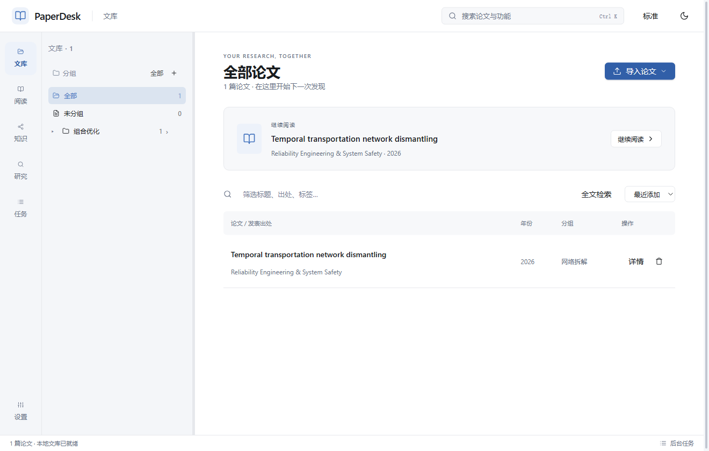

# PaperDesk v0.1.0

本地论文研究工作台，支持 PDF 阅读、批注、翻译、笔记、知识库和文献检索。

[源码仓库](https://github.com/JackieYuwhu/paperdesk) · [程序发布页](https://github.com/JackieYuwhu/paperdesk/releases) · [部署说明](docs/DEPLOY.md)

## 安装与启动

Windows 程序包与源码分开发放：程序包放在 Releases，仓库保存源码、测试和文档。公开版本不包含个人文库、API Key、运行日志或开发机的 Git 历史。首次启动后，在设置中选择 OpenAI 或 Anthropic 协议并填写自己的服务配置；也可先使用本地文库功能。

当前程序包**没有内置 Python**。PDF 解析等功能需要 Python 3.10+，使用程序包中 `resources/python/requirements.txt` 安装依赖；可通过 `PAPERDESK_PYTHON` 指定解释器。

从源码运行需要 Node.js 22.18+、Python 3.10+ 和 Windows 原生模块构建工具：

```powershell
git clone https://github.com/JackieYuwhu/paperdesk.git
cd paperdesk
npm ci
python -m pip install -r python/requirements.txt
npm run dev
```

构建公开 Windows 安装包运行 `npm run dist`，产物在 `release/`。该命令只打包程序资源；个人数据快照需另行显式执行下方的自用打包命令。

仓库的 **Actions → Release Windows → Run workflow** 可在干净的 Windows 环境中执行完整测试、构建安装包，并发布对应版本的 Release 和 SHA-256 校验文件。首次添加发布工作流时也会触发；已有版本保持原样，不覆盖已有附件。发布说明见 [v0.1.0](docs/RELEASE-v0.1.0.md)。

## v0.1.0：设置与模型接口（2026-11-17）

PaperDesk 是本地论文研究工作台，提供 PDF 阅读与批注、保版式翻译、论文拆解、笔记、知识库、文献检索和批处理。

- **重新设计的设置页**：左侧七类导航，右侧卡片分区，底部固定保存。模型服务、阅读与翻译、AI 与自动化、检索与知识、提示词与技能、数据与集成、外观与诊断分别管理。
- **两类模型接口**：OpenAI Chat Completions 与 Anthropic Messages。问答（含流式）、拆解、翻译、视觉识别和连接测试使用对应协议的地址、鉴权与消息格式。第三方兼容网关按其提供的协议选择，不按模型品牌猜测。
- **密钥保护**：模型 Key 使用 Electron safeStorage（Windows 系统加密）保存；界面只读取“是否已配置”。学术服务 Key 留空时保留已有值，设置导出不包含密钥。新输入的 Key 默认隐藏。
- **本地数据独立**：程序资源与文库分开保存。生产构建只包含代码与运行依赖；不会自动把开发机文库、日志、缓存或 Key 打进程序资源。

### 本机自用包

以下命令仅用于创建本机个人快照，产物不属于公开发行内容。

```powershell
npm run dist:personal
```

生成 `release/private/PaperDesk-v0.1.0-personal-win-x64.zip`。完整解压后运行 `Start-PaperDesk.cmd`：它启动正式版 EXE，使用包内 `data/` 的个人文库快照，并复用本机 Python。现有 `%APPDATA%\paperdesk\data` 保留原样；后续数据保存在所选启动方式对应的文库中。

个人快照使用 SQLite 在线备份并检查完整性，包含论文、笔记、分组和已有设置；模型 Key 保持加密形式，需要原 Windows 用户账户。**自用包含个人数据及加密凭据，请勿上传 GitHub 或转发。** 打包目录已加入 Git 忽略规则。

只想使用原来的实时文库时，可直接运行解压目录中的 `app/PaperDesk.exe`。请选定一种启动方式持续使用，避免误以为两份文库会自动同步。

Python 解析服务目前仍需要 Python 3.10+ 与 `python/requirements.txt` 中的依赖；自用启动器指向打包时本机 Python，不会把整个 Conda 环境复制进来。源码开发与测试需要 Node.js 22.18+（CI 使用 Node.js 24）。

## 工作区 UI 与启动优化（2026-11-13）

主界面更新为「文库 / 阅读 / 知识 / 研究 / 任务」五个工作区。启动默认进入本地文库，不自动解析上次全部打开的 PDF；原有标签和当前文档继续保留，点击「继续阅读」恢复阅读。

- **文库**：左侧保留分组树、层级拖动、新建与管理；主区使用宽列表，显示标题、发表出处、年份、分组和标签。支持标题/出处/DOI/标签筛选、最近添加/年份排序、详情与删除；父分组包含子分组。首屏最多展示 80 条，按需显示更多。导入按钮集中提供 PDF、文件夹、链接入口；全文检索继续使用原搜索服务。
- **阅读**：打开论文后默认收起文库栏。笔记、AI、翻译、拆解等工具在右侧按需展开；切回文库不会销毁已打开的阅读器。页面管理、重译本页、目录、文内查找、解析检查等入口收进「更多工具」；顶栏可进入/退出专注阅读。PDF、批注、翻译、删除页/版本恢复仍沿用原业务服务。
- **知识**：知识库、思维地图在主区展开，可通过顶部页签切换；暂存区继续使用原审核与发布流程。来源深链与译文打开会切回阅读工作区。
- **研究与任务**：文献检索、相关论文、研究方向、领域调研等有独立大面板；任务中心复用现有批处理管理、进度、取消及重试。底部状态栏显示文库状态和后台任务事件。
- **全局操作**：`Ctrl+K`（macOS 为 `Cmd+K`）打开论文标题/功能搜索，支持键盘 Tab、Esc；`Ctrl+F` / `Cmd+F` 在非输入状态展开文内查找。标准/紧凑密度持久化；浅色/深色主题使用同一套语义色。减少动效偏好生效。



### 启动策略与测量边界

PDF 阅读器、对照视图、研究、AI、批处理、地图、知识库和设置使用动态代码分包，只在需要时加载；首次文库不请求 PDF 阅读器资源。读过的 PDF 组件随后保留，切换工作区不主动清空页码和画布；译文预解析推迟到用户进入过阅读器之后。数据库结构迁移和批处理恢复仍保持原有正确性顺序，笔记文件名整理移到窗口显示后执行，每 20 条让出主线程，退出时停止。

主进程日志包含 `[startup] database-ready`、`window-visible`、`maintenance-done`；渲染层 performance marks 包含 `paperdesk-renderer-start` 和首次 `paperdesk-library-ready`。主进程日志从主模块初始化起计，渲染 marks 从页面导航起计；隔离验收另记录进程启动至文库首屏可用的 `firstReadyMs`。这是测量入口，不是性能承诺；大文库、机械盘、首次系统冷启动仍需在目标机器测量。

### 验证

运行 `npm run test:workspace`：先构建，再以独立临时 userData 和数据目录启动真实 Electron，生成两页 PDF，仅使用隔离元数据，验证工作区切换、首次不加载阅读器、PDF 渲染、页码保留、右侧 AI、页面管理入口、任务/研究/知识库、命令面板、1000px 窗口和暗色。截图与测量结果位于 `.tmp-shots/workspace/`。此测试不验证真实模型质量或外网可用性，不读取用户真实密钥或文库。


论文阅读 / 批注 / Markdown 笔记 / 引文工具（Electron 桌面应用）。


## 当前修复与后续计划（2026-10-24）

下一阶段的证据、优先级、复现步骤与验收标准见 [PLAN.md](PLAN.md)。

本轮（2026-10-24）主要解决「翻译慢 / 一直停在分析版面 / 取消没反应」：

- **按页复用的矢量解析**：`_figure_regions` 由 O(n²) 两两比较改为「栅格筛候选 + 原始相邻判定确认」，结果逐页等价（83 页比对 0 差异）。30 页矢量图密集论文的分析阶段由 **385s 降到 12s**。
- **表格检测收敛**：模块层已给出保护区时不再跑 `find_tables`（表格/图内文字本来就不翻译）；图元 >4000 的页面跳过检测（该函数在 3.7 万图元页面上会退化到分钟级）。
- **病态页保护**：单页矢量图元 >2000（`PAPERDESK_MAX_PAGE_DRAWINGS` 可调）时保留原文，不做擦除/回填，并在 warning 中列出页码。实测单页 `apply_redactions` 在 37,711 图元时要 **249s**。
- **保存参数自适应**：复杂文档用 `garbage=1` 且跳过 `clean`（`garbage=3 + clean` 在同一文档上 >400s，`garbage=1` 只需 3.5s）。
- **覆盖检测不再逐块建 TextPage**：改为每页建一次并复用（30 页论文 677 个块的写回从 100s+ 降到数秒）。
- **取消真正生效**：分析每页、写回每页、术语抽取前都检查取消标志；实测点击取消后 13 秒内中止（当前页若正在 `get_drawings()` 属 MuPDF C 调用，无法中途打断）。
- **翻译吞吐**：并发 4 → **24/32**、按段数自适应批大小、去掉串行预检、失败改「对半拆」、HTTP 连接复用。12 页论文翻译阶段由 ~216s 降到 **37~88s**。
- **术语表**：自动从摘要/正文抽取 24 个术语（关闭思考的一次请求，按内容哈希缓存），与设置里手填的术语表合并后注入每个 system prompt；QA 与 warning 中可见实际使用情况。
- **进度可见**：分析阶段显示「分析版面 n/N 页」。

### 翻译速度第二轮（2026-10-24）

上一轮解决的是「请求本身太慢」，这一轮继续压**请求数与单请求延迟**：

- **不再按章节拆请求**：`(内容类型, 章节)` 分组改成默认只按内容类型分组（只有用户自定义 prompt 里用到 `{section}` 时才按章节拆）。30 页论文里「章节数 × 类型数」会把请求数放大 2~4 倍，每个请求都要白付一次延迟。
- **一波发完的批大小**：`pick_batch_size` 选「请求数 ≤ 并发数」前提下**最小**的批（上限 16 段）。此前按 `段数/并发` 取整，常出现 25 个请求 / 24 并发 → 多出一整波。纯调度模拟（延迟模型取自真实端点实测：4 段 42s、8 段 61s、16 段 127s）：117 段样本 **44 请求/2 波（≈93.5s）→ 21 请求/1 波（≈52s）**；并发 32 时 ≈43s。
- **关闭模型思考**（默认开）：翻译请求体带 `thinking: {"type": "disabled"}`。论文段落翻译不需要推理，开着思考时单请求要多等几十秒（上一轮术语抽取关思考约 5s，而 4 段翻译要 42s）。严格校验的服务器若拒绝该参数，侧车会**自动去掉并重试一次**（进程内记住），不影响其它网关。设置 → 翻译 →「翻译时关闭模型思考」可关掉；`mt.thinking` / `PAPERDESK_MT_THINKING`。
- **术语表与分析重叠**：术语抽取在「合段完成」就发后台请求，与保护区/引用清洗计算并行，翻译前只等剩余部分（最多省下约 5s）。
- **并发默认值**：OpenCode 网关 32，其它端点 24（上限 32）。

> 「关闭思考」的端到端收益需要真实模型基准（本轮无可用 Key，未把估算当验收）；调度收益由离线模拟测得，模拟的延迟曲线来自上一轮同一网关的真实实测。

### 阅读渲染与后台翻译（2026-10-24）

- **首屏不再等「全部页面」**：`ScrollPages` 只取第一页尺寸就开始上屏，其余页按第一页占位、渲染到真实页面时再修正。此前打开大文档/译文会先 `for 1..numPages getPage`，期间整片空白——这是「切到不常用 PDF 长时间白页」的主因。
- **页面骨架**：未出图的页面显示浅色流光骨架（`.scrollpage:not(:has(canvas[data-rendered='1']))`），不再看起来像卡死。
- **译文 PDF 预解析**：`preloadTranslationDoc` 在译文就绪后空闲时读盘 + `pdf.js` 解析并保留在 `docCache`；打开「中英对照/译文」不再先空白等解析（译文内嵌 CJK 字体，首开通常比原文更慢）。
- **文本层延后**：位图提交后再异步建文本层，不占渲染并发位；译文页 CJK span 很多时，后续页的位图能更早出来。
- **翻译在后台继续**：切到别的文档不会取消翻译（主进程任务本来就在跑）；进度按附件记录，切回时恢复显示，`Translating` 状态也只对**当前附件**生效，不会再让另一篇的「开始翻译」按钮被误禁用。

> 代码定位请看 [docs/CODE-MAP.md](docs/CODE-MAP.md)。**修改任何代码后必须同步更新这张表**（功能/文件/函数/行为），否则视为未完成。

### 九项体验/性能修复（2026-10-27）

本轮针对真实使用中的九个问题，详细方案/根因/取舍见 [docs/FIXES-2026-10-27.md](docs/FIXES-2026-10-27.md)：

- **文库变大后切页卡**：作者信息改为一次批量本地查询（去掉逐条 IPC）；原文/中英对照两套阅读视图同时挂载、只切显隐，切视图不再重建 `PdfViewer`；屏幕外页面 `content-visibility`，用户滚动时后台回填暂停 800ms。
- **翻译表格消失/压坏**：表格检测提前到合段之前，同时用线条聚类和 `find_tables` 网格识别三线表/无竖线表；表格区域成为合段、擦除、回写三道屏障，表格外正文照常翻译。当前**表格内文字保留原文**，优先保证表格完整不消失。
- **DOI/arXiv 导入失败**：补齐 DOI 内容协商、OpenAlex/Unpaywall、Crossref、出版社 `citation_pdf_url`、arXiv 与直链校验的兜底链；输入框改单行；失败给出具体步骤，不再静默。批量导入单条失败不影响其它条。
- **文库分组（多级）**：`library_groups` 保存分组树（`parent_name/description/date_modified`），`items.group_name` 保存完整路径；顶部“全部/未分组/各组”过滤与计数，父组统计包含全部后代；分组行悬停弹出子分组菜单（可继续建子组）；导入在**主进程同一事务**内归组，连续上传不会失效；**已有论文在详情面板的“分组”输入框**填 `父/子` 即可移动或新建层级，不再依赖行内文件夹按钮。分组栏可显示/编辑分组介绍。导入后后台识别出论文标题时会自动同步条目名与磁盘 PDF 文件名；旧 `a/b` 路径数据会自动补出父级。
- **论文标签（独立于分组）**：详情页可为论文添加/删除自由标签；文库支持按标签筛选，行内显示原始标签 chip；批处理可选“按标签”执行，一个标签命中多篇时按并集处理。标签不会再被分组名覆盖，领域标签继续保留。
- **切页闪一下**：修掉 `resetKey` 里的 `viewMode`，同文档切原文/对照不再重置阅读器；隐藏视图保留页码、滚动与位图缓存。
- **正文/参考文献/附录**：翻译侧按标题规则给每页打 `body/references/appendix/front_matter`；参考文献不强制翻译，附录按正文翻译并按正文验收；翻译面板显示页面结构。
- **右侧译文反向联动**：对照视图支持双向滚动/翻页，用 origin 标记防回声；关闭工具栏“联动”后两侧互不驱动。
- **图表浮窗缩放**：50%–300% 缩放，按缩放后的 scale 重新渲染区域，不是 CSS 拉伸；放大后可滚动查看。
- **问答去掉模式切换**：固定混合检索（hybrid），删除“混合/语义/词法”选择器；后端仍兼容旧参数。

> 旧译文不会自动获得表格保护/页面角色等新字段，需要重新翻译；表格内文字翻译与万篇文库压测不在本轮范围。

### 分组 / 标签 / 批处理（2026-10-28）

- **多级分组**：分组按完整路径保存，父组悬停展开子组；分组栏可显示和编辑介绍；详情页输入 `父/子` 可移动已有论文，导入时在主进程同一事务归组，不再出现“传 4 篇后不动了”。
- **标签独立**：新增独立标签系统，详情页可增删标签，列表可按标签筛选；分组不再覆盖领域标签。
- **批处理按分组/标签**：范围选择增加“按标签”，分组仍包含全部子组；两者都在创建时快照。
- **批量任务全部 400**：根因是模型名填了展示名；设置层会把 `DeepSeek V4.1 Flash` 等归一成 API 模型 ID，已用真实 Key 测试通过。
- **单页重译**：阅读器新增「重译本页」（仅译文栏可用）。只抽当前页重译并替换回原页，保留 1:1 页码；图元密集页（如算法/图表很多）会绕过整篇翻译的“重页保原文”保护，显式重译时允许走擦除/回填，但可能较慢。重译后会换新 PDF 文档并清掉画布/文本层缓存，右栏不会继续显示旧页。
- **“少一段/少个代码块”的边界**：整篇翻译对图元过多的页默认保留原文（防整篇卡死），这是代码块/图表页看起来“漏翻”的常见原因；现在可用「重译本页」逐页修复。真正的整页漏译仍会在验收里标为未通过。
- **公式不再拖累整段**：抽取时按“公式行 / 正文行”拆块，独立公式只保护自己、不擦除也不翻译；公式前后的正文照常翻译，避免“一行公式导致整段跳译”。单页重译的临时 PDF 从第 1 页开始，编号正文段也不会再被误判成首页作者行。行内公式仍保留在正文中看原文，后续可再做可选 LaTeX。
- **单文件导入也有领域标签**：单个/批量/链接导入都会等元数据与领域识别完成再返回；模型不可用时按标题关键词兜底（可能落到“综合研究”），不再出现“一次传 5 篇有标签、单传 1 篇没标签”。
- **切换论文时原文/译文同源**：切换条目会等新条目译文打开后再原子切换附件，左原文不会停留在上一篇；译文是旧版时会在顶部提示重新翻译。
- **左栏分组介绍/标签栏固定**：分组介绍、全部标签使用固定高度，只有论文列表滚动，不再被列表挤压或遮挡。
- 详细方案/取舍见 [docs/FIXES-2026-10-28.md](docs/FIXES-2026-10-28.md)。

### 最新论文优先（2026-10-25）

新领域里「按被引排序」会把近两年的工作挤下去，因此检索默认改为**最新优先**：

- **文献检索**：新增「排序」下拉（最新优先 / 被引最多 / 相关度），默认最新；OpenAlex 用 `publication_date:desc`，Google Scholar 用 `sort_by=date`，Crossref 用 `published` 倒序，Semantic Scholar 在当前页内按年份重排。
- **相关论文 / 研究方向**：新增「最新优先 / 高被引」切换；施引文献改为按发表时间倒序，并额外补一轮「近两年、标题相近」的论文（避免 related_works 全是旧文）。列表也按所选排序展示。
- **领域调研**：候选默认「最新优先」，补完摘要/年份后再排一次；可切「高被引」看经典工作。
- 旧的相关论文有缓存时，点「开始查询」重新拉取；缓存不会自动失效。

> 若仍只看到旧论文：确认年份范围留空、关键词用英文/领域标准词，并点一次「开始查询」；OpenAlex/Crossref 对新论文的收录本身可能有几天到数周延迟。

### 快速翻页 / 拆解提速 / 领域调研 / 翻译验收（2026-10-24）

- **快速翻页不再闪白**：可见画布改为**双缓冲提交**（新 canvas 画好后再同帧替换旧 canvas，旧画面保留到替换那一刻）；已出过图的页不再播放骨架动画；`releaseDistant` 改为「迟滞 + 够用即停 + 最远先释放」，跳页保留窗口从 ±2/±3 扩大到 ±4/±6。根因是 384MB 位图预算下约 17 页就触发清空，而旧实现会把窗口外所有已上屏页一次清掉。
- **拆解提速**：长文分段 map 阶段默认 4 路并发（`analysis.workers` / `PAPERDESK_ANALYSIS_WORKERS`），多篇对比卡片默认 4 路（`analysis.cardWorkers`）；单段失败重试 1 次后写占位、不中断整篇。**智能路由**：短分段（<4000 字）走快速模型，长分段/合并/对比/单篇成稿走强模型；两者留空则回退默认模型（`analysis.fastModel` / `analysis.strongModel`，设置 →「拆解」）。8 项假调用实测串行 2447ms → 并发 4 的 628ms（3.90×）。
- **领域调研（新面板）**：选几篇种子论文（或填检索词）→ Google Scholar（SerpAPI）+ OpenAlex 检索 → 默认 **24 路并发**做「标题+摘要级」快速拆解 → **4 个视角（方法创新/证据强度/领域相关性/入门价值，最多 6 个）**并行打分并合并推荐理由。候选可一键加入文库；需要全文精读时再逐篇走「拆解论文」。Google 结果没有摘要时用 OpenAlex 按 DOI/标题补齐；未配置模型时离线占位、不联网调模型。
- **翻译按页验收 + 自动重译**：写完逐页验收（正文块写入比例 ≥0.6 且原文已覆盖；图形过多整页保留的页标 skipped），未通过页默认最多 3 页自动「打回重译」：抽成单页临时 PDF 重译后替换回原页（保持 1:1），默认 2 线程、替换串行；结果写入 `qa.verification`，翻译面板显示「验收：通过 / N 页未通过（已重译 M 页）」。阈值/上限可用 `PAPERDESK_TRANSLATE_VERIFY_RATIO` / `PAPERDESK_TRANSLATE_RETRY_PAGES` / `PAPERDESK_TRANSLATE_RETRY_WORKERS` 调整。

### 后端静默 / 倾斜译文 / 句级高亮 / 期刊补全（2026-10-24）

- **后端静默**：Python 侧车（uvicorn）以 `windowsHide: true` 启动，Windows 上不再弹出额外的控制台窗口；界面只保留前端。侧车日志仍写入 `userData/data/logs/sidecar.log`，排查问题不受影响。可选 OCR CLI（pix2tex）也做了同样处理。
- **倾斜文本保持角度**：抽取时记录每行文字方向（`line.dir` → `angle`），译文用 `TextWriter` 在旋转后的坐标系里排版，竖排轴标题、旋转表头、斜排标注不再被强行摆平；小于 1° 的扫描微倾斜仍按水平处理。旧译文需重新翻译才会带角度。
- **选中一句不再高亮整段**：`.map.json` 新增 `segs`（源句 ↔ 译句多对多对齐）。模型合并/拆分句子时按句子长度比例对齐，选中原文第一句只映射到对应译句；旧译文没有 `segs` 时退回旧行为。同一行内的多句按字符占比切分矩形，避免整行重复。
- **期刊来源补全**：以前 PDF 抽取只拿到标题/作者，`venue` 几乎总是空；现在抽取后若缺 `venue/year/doi`，自动按 DOI 或标题查 **Crossref/OpenAlex**（标题相似度阈值 0.9，8 秒超时，失败留空不写错）。已有摘要的论文也会补全，不再被旧逻辑整段跳过。存量条目可在「文档详情 → 期刊/出处」点「补全期刊/来源」，或在元数据面板重新识别。

> **Google Scholar 与 VPN**：Google Scholar 只用于「文献检索」和「被引次数」，通过 **SerpAPI**（`scholar.apiKey`）访问，**通常不需要 VPN**；它不会补期刊名。期刊/来源来自 Crossref/OpenAlex（直连，无需 VPN）。只有在浏览器里手动打开 `scholar.google.com` 时才需要能访问 Google 的网络；若本机连 `serpapi.com` 都访问不了，才需要给应用配置代理。

**Google Scholar 不可用时的替代**：

- 应用内「文献检索」与「领域调研」已内置 **OpenAlex（默认，无需 Key）** 与 **Semantic Scholar**；「领域调研」的「自动」模式是 Google + OpenAlex，两家都空时再回退 Semantic Scholar。
- 「领域调研」面板提供 **Archive Scholar / Semantic Scholar / OpenAlex** 网页入口按钮，可直接在浏览器打开，不依赖 Google。
- 推荐的无门槛检索/图谱入口：`scholar.archive.org`（Internet Archive Scholar）、`semanticscholar.org`、`openalex.org`、`connectedpapers.com`、`lens.org`、`aminer.cn`。
- 不建议依赖「谷歌学术镜像站」：多为非官方抓取、随时失效/CAPTCHA，且可能违反 Google 条款；应用不内置镜像抓取，只保留上述官方/公开接口与网页入口。

### 文库文档详情（2026-10-24）

- **双击文库条目** → 左栏显示该文详情（不弹窗）：作者、期刊/出处、年份/领域、附件与页数、DOI。
- **主要思想**：优先沿用**已保存的「论文拆解」小节**（拆解面板「归档到笔记」或批处理的论文拆解默认归档写入；存在多份时取最新一份）；没有拆解时退回摘要，并标注来源。
- **被引次数**：Google Scholar（SerpAPI，设置 → 其他填 Key）优先；未配置或未匹配时用 Semantic Scholar 兜底并标注来源；都失败时给出可读说明。结果缓存 6 小时，可手动刷新。点击「在 Google Scholar 查看」用浏览器打开检索页。
- **返回**：详情左上角 ← 返回文档列表。详情里的「在笔记中查看完整拆解」直达该条目的笔记面板。
- **重命名文件**：双击论文进入详情，点标题旁的“编辑名称”；Enter 保存、Esc 取消、失焦也保存；同时改条目标题与磁盘 PDF 文件名（重名自动加序号）；书目元数据保持原样，不会被改名覆盖。列表行不再显示改名铅笔。
- **上传后即时出现**：PDF 上传返回与后台抽取解耦；抽取完成会广播文库变更，列表/元数据/批处理面板立即刷新，不必等下一次上传。


同一篇 30 页论文（`A multi-agent system for automating scientific discovery`）全流程：**修复前 >900 秒（等同卡死）→ 修复后 34.7 秒**（本地阶段；不含模型时间）。

使用注意：修改侧车代码后须重启应用，并对旧结果执行“重新翻译”。旧译文不会自动重建。
内置保版式翻译保持源页数，放不下的完整译文按源页保存到 `.overflow.json` 和 Markdown；这不等于所有段落都能在原版面成功排入。
视觉翻译有独立排版路径，其溢出和取消边界仍需修复，详见计划。

已运行通过：类型检查、主进程单测（含并发/路由、文库导入纯函数/分组迁移）、坐标测试、完整 Python 测试（含表格保护、页面角色、按页验收/自动重译）、SQLite 冒烟、生产构建、Electron 端到端（E2E_OK，覆盖阅读器渲染/快速翻页闪白回归/双缓冲画布/双向对照联动/图表缩放/领域调研/翻译/批处理/数据安全）。构建时把 `TEMP` 指到工作区目录以绕开沙箱临时目录权限；正常桌面环境直接 `npm run build` 即可。九项修复的方案与边界见 [docs/FIXES-2026-10-27.md](docs/FIXES-2026-10-27.md)。
翻译性能数字来自单机真实端点实测；网关侧单请求延迟本身有 1.5~2 倍波动，因此总耗时会在同一配置下浮动。调度收益用离线模拟测得（延迟曲线取自同一网关的真实实测），「关闭思考」的端到端收益仍需真实模型基准。

<details>
<summary>上一轮（2026-10-23）已修复</summary>

- 内置引擎数学文本写入失败时，不再计入成功写入或生成成功映射；尝试回填原文，回填失败单独计入 `coverage.fallbackFailed` 并告警。
- 合法重复数学变量（例如 `𝑥𝑥`）不再按字符相同无条件合并。
- 前台翻译按独立请求 ID 关联取消、进度与生命周期，支持启动完成前请求取消；批处理调用不会覆盖前台句柄。
- 状态请求断连或 5xx 时有界退避；进程存活时保留产物，不以短暂健康检查超时认定进程退出。

</details>

## 核心目录与流程

| 目录 | 职责 |
|---|---|
| `python/app/` | FastAPI 侧车、PDF 抽取、模块识别、公式、翻译与排版 |
| `src/main/` | Electron 主进程、IPC、模型配置、翻译任务、批处理与产物登记 |
| `src/renderer/src/` | React 阅读器、对照视图、翻译与 AI 面板 |
| `src/shared/` | 类型、协议和跨进程共用纯函数 |
| `python/tests/`、`scripts/` | Python、主进程、坐标与 Electron 端到端测试 |

翻译主线：附件 → 主进程启动侧车任务 → 结构化抽取/区域保护 → 分批翻译 → 公式还原 → 写回 PDF 与映射/溢出产物 → 登记译文 → 对照阅读。
开发约束见 [翻译开发手册](.opencode/skills/paperdesk-translate/SKILL.md)。
代码功能对照表见 [docs/CODE-MAP.md](docs/CODE-MAP.md)：按「功能 → 文件/函数」定位，**改完代码必须同步更新该表**。

## 环境要求与测试
- **Node** ≥ 20（见 `package.json` 的 `engines`）；**Python** ≥ 3.10 —— sidecar 由应用**外部调用**，需自行安装（本项目不自带 Python 运行时）。
- 依赖安装：`npm ci`；Python 依赖：`python -m pip install -r python/requirements.txt`（版本已锁定，保证可复现）。
- **一键检查**：`npm run ci`（等价 `npm test`）依次执行 类型检查 → 主进程单测 → 坐标单测 → Python 单测 → 冒烟。
- **测试数据隔离（测试绝不写入你的真实数据目录）**：
  - 端到端 `npm run test:e2e` 使用临时 userData（`mkdtemp('paperdesk-e2e-')`）；
  - 冒烟 `npm run smoke` 使用**内存 SQLite**（`:memory:`），不落盘；
  - Python 单测使用 `tempfile` 临时目录；
  - 主进程数据目录支持用环境变量 `PAPERDESK_DATA` 覆盖（默认 `<userData>/data`）——CI/测试可用它彻底隔离。
- **样例与评估**：`npm run corpus` 生成样本集（单栏/双栏/扫描件/公式/中文，输出到 `samples/corpus/`）；`npm run eval` 跑抽取+分类+翻译(mock) 与性能测量，结果写入 [`docs/EVAL.md`](docs/EVAL.md)。
- **安装预检**：`npm run preflight`（校验 Node/Python/依赖/sidecar 能否启动）。
- **文档**：[部署与发布](docs/DEPLOY.md) · [试用手册](docs/TRIAL.md) · [评估记录](docs/EVAL.md) · [扩展指南](docs/EXTENDING.md) · [历史交接](docs/HANDOFF.md)。

当前阶段：**核心功能已具备，持续进行翻译可靠性与阅读体验优化**
- [x] Electron + React + TS 工程（electron-vite）
- [x] 本地 SQLite 数据层（better-sqlite3）
- [x] 类型安全的 IPC（contextBridge 白名单）
- [x] 导入 PDF → 建 item + attachment → 复制进 `data/storage/`
- [x] pdf.js 阅读器（翻页 + 缩放 + 文本层）
- [x] **M1 批注**：高亮 / 下划线 / 便签，存库持久化，缩放后坐标不漂移
- [x] **M2 笔记 + 深链**：Markdown 笔记（落 `.md` 文件）、批注一键入笔记、`paperdesk://` 深链跳回原文
- [x] **M3 作者/引用识别**：Python sidecar + PyMuPDF 抽取标题/作者/参考文献 + DOI 解析；可选接 GROBID / Crossref
- [x] **M4 相关论文图谱**：OpenAlex 拉参考文献/施引文献/相关论文 → 力导向引文图（Cytoscape）+ 一键入库
- [x] **M5 保版式翻译**：内置逐块覆盖式翻译引擎（位置稳定）+ 可选 pdf2zh；阅读器原文/译文切换
- [x] **M6 全文检索 / RAG**：FTS5 全文检索（条目/全文/笔记）+ RAG 问答（答案带出处，可点跳原文页）
- [x] **M7 模块化 + 设置**：主进程模块注册中心、渲染面板注册表、可视化设置（AI/翻译/其他，密钥加密存储）
- [x] **M8 UI 深度优化**：设计令牌 + 明暗主题 + 内联图标体系 + 阅读器按宽度自适应 + 面板懒挂载保活
- [x] **M9 语义检索**：可插拔向量后端（mock/openai）+ 向量存储 + **混合检索（FTS5 + 向量 RRF 融合）**
- [x] **M10 批处理模块**：任务可注册（翻译 / 论文拆解 / 翻译+拆解）+ 队列与并发 + 产物目录

> 以下为已实现的功能概览，不代表所有边界场景均已验收。**新增功能请见 [`docs/EXTENDING.md`](docs/EXTENDING.md)**。

## 批处理模块（M10）
- **任务可注册**（`src/main/services/batch/registry.ts`）：每类任务是一个 `BatchTaskHandler`，加一行即可扩展。面板只暴露以下三类：

  | 任务 | 粒度 | 说明 |
  |---|---|---|
  | `translate` | 附件 | 保版式翻译，产物 PDF / Markdown / ZIP |
  | `analyze-paper` | 附件 | **论文拆解（paper-analysis）**：八项结构化分析（带 `[p.N]` 定位），默认归档到该条目笔记 |
  | `translate-analyze` | 附件 | **翻译 + 论文拆解**：先翻译，再基于译文/原文拆解并归档 |

- **极简创建**：不再显示长说明、研究方向、批次对比、归档开关、分析维度、汇总笔记、执行方式等参数；翻译/拆解使用固定默认值（拆解不再额外生成批次对比，翻译会复用已有同签名译文）。选任务、选范围即可创建，创建后立即入队。
- **报告文件名可读**：拆解报告命名为「论文标题.analysis.md」，超长标题在空格处截断，重名加 ` (2)`；旧版本用附件 key 命名的报告会在下次打开批处理列表时自动改名，并同步数据库与 `index.md` 链接。若数据库里的产物目录来自另一份数据副本，会回退到当前数据目录下的同名批次。
- **队列**（`queue.ts`）：并发控制（默认 1，可设 1–4）、逐项进度事件、失败不中断、作业/条目持久化到 `batch_jobs`/`batch_items`，应用重启自动恢复未完成作业。
- **失败处理**：作业卡片可展开看每项失败原因、复制/导出失败清单，并只重试失败项；不再提供「重跑全部失败作业」。
- **产物**：`data/batch/<jobKey>/`（md / json / assets），面板可一键打开目录。
- 前端：批处理面板（任务/范围 → 创建；作业卡片含进度条、状态、取消/打开/删除、展开看每项结果）；创建后自动清空状态/关键词/失败原因筛选，保证新作业立刻可见。拆解报告归档成功后，明细里会出现「查看笔记」，直接跳到该论文笔记里的「论文拆解」小节。

## UI 设计（M8）
- **设计令牌**：`styles.css` 顶部定义颜色/圆角/阴影/间距/字体变量，`html[data-theme]` 切换浅色 / 深色（设置里可改，即时生效并持久化）。
- **图标体系**：`components/Icon.tsx` 内联 SVG（线性风格，继承 currentColor），工具栏/标签/按钮统一用图标而非文字或 emoji。
- **布局**：左栏（品牌 + 搜索 + 列表）/ 中栏（工具栏 + 阅读器）/ 右栏（图标标签页）。
  - 阅读器工具条 `position: sticky` 固定在页面之上，**默认按容器宽度自适应**（点百分比可重新适配）。
  - 页面纸张居中，画布为柔和中性底 + 点阵纹理；选中/批注/浮动卡片样式统一。
- **面板懒挂载 + 保活**：切标签不丢状态（图谱、AI 结果等），图谱在重新显示时自动重算尺寸、并随主题换色。
- 想看效果：`npm run shots`（用 CDP 给各界面截图到 `.shots/`）。

## 界面文案与细节

- 界面上只保留一行必要说明，完整解释放在本文档。
- 思维地图：根节点是当前文献标题且不可删除；「从论文结构生成骨架」不依赖 AI 也能起树；「AI 摘要 / AI 优化 / 找支撑段落」需要 设置 → 模型服务；AI 优化先给差异预览、逐项接受后才改图，应用后可一次性撤销；地图按文献分别保存（关闭面板或重启后仍在）；导出用「导出 Markdown / 导出 Mermaid」，保存位置由你选择。
- 设置 → 模型服务：填好 Base URL 与 API Key 即启用真模型（问答 / 翻译 / 划词翻译 / 语义检索 / 批处理共用）；留空走离线占位，可试用但不产生真实翻译与语义；用 OpenCode Go（https://opencode.ai/zen/go/v1）时应用会自动带 User-Agent 与会话头 x-opencode-session。

## 思维地图（分级 / AI 优化）
- **三级视图**：工具栏「论文 / 分组 / 全部」切换。论文级可编辑；分组级按 `items.group_name` 聚合；全部级按论文聚合，节点右侧「打开」在独立窗口里看该论文的地图（同一论文复用同一窗口）。
- **全文显示**：节点正文用 `pre-wrap + overflow-wrap` 完整显示，不再截断成省略号；映射进地图的文本会先经 `stripMarkdownForMap` 去掉 Markdown 标记。
- **交互**：`+ / − / 适配` 与 Ctrl+滚轮缩放（0.4–2.0，按论文记忆）；空白处拖拽框选、Ctrl/Shift 追加、`Esc` 清空；选中多个后可整体拖动、批量删除/折叠/对齐。
- **点锚定位**：「找支撑段落」返回页内矩形 `anchor {page, quoteStart, quoteEnd, rect, moduleId}`，无 bbox 时退化为页级并明示。
- **AI 优化整图**：工具栏「AI 优化」不需要先选中节点，按整图大纲让模型重新分组、合并重复生成节点；结果先出差异预览，可逐组接受，整份改动可「撤销上一步」。没有模型时给出可读提示且不改图。
- **同步语义**：批处理「同步到思维地图」是**覆盖式**——上一次同步产生的节点会被替换，用户手写节点永不删除；「同步到知识库」只会生成待审核提案，不直接发布，需在暂存区逐条或整批批准。
- **AI 工具库**：设置 → AI 工具库按「阅读 / 翻译 / 知识库 / 思维地图 / 检索」分类列出所有 AI 能力，可整体或按权限（调用模型 / 联网 / 写知识库）关闭；关闭后对应按钮变灰并说明原因。界面只保留操作与一句话提示，详细说明以本文件为准。

## 语义检索（M9）
- **向量可插拔**（`services/embed.ts` + sidecar `/embed`）：`mock`（离线哈希向量，开箱可用）/ `openai`（任意 OpenAI 兼容 `/embeddings`）/ `none`。
- **存储**：分块向量存入 `chunk_embeddings(chunk_id, model, dim, vector BLOB)`；抽取全文时**自动建索引**（best-effort，失败不影响抽取）。
- **混合检索**：`services/search.ts` 的 `searchHybrid()` 用 **RRF 融合**词法（FTS5/bm25）与语义（向量余弦）结果；无索引时自动退化为词法。
- **问答固定混合检索**：AI 面板不再显示「混合 / 语义 / 词法」切换；`ai.ask` 固定走 hybrid，后端仍兼容旧 `mode` 参数。
- 配置：设置面板「语义检索」区（Base URL / 模型 / Key 未填时自动复用 AI 那组）。

## 模块化 & 设置设计（M7）
- **主进程模块注册中心**（`src/main/modules/index.ts`）：每个功能是一个 `MainModule { id, title, registerIpc, onStartup?, onShutdown? }`；`registerAllModules()` 启动时统一注册。新增功能 = 加一行。
- **渲染进程面板注册表**（`src/renderer/src/modules/registry.tsx`）：右侧标签栏与面板渲染全部由 `PANELS` 生成。新增面板 = 加一行。
- **设置界面**（⚙ 按钮）：可视化配置 ——
  - AI 问答：后端（mock / OpenAI 兼容）、Base URL、模型、API Key；
  - 翻译：引擎（内置 / pdf2zh）、后端（mock / none / OpenAI 兼容）、Base URL、模型、API Key；
  - 其他：OpenAlex 邮箱（polite pool）、GROBID 地址。
  - **模型名**：填 API 模型 ID（如 `deepseek-v4.1-flash`），不要填界面展示名；设置层会把 `DeepSeek V4.1 Flash` 等已知展示名归一成 ID，避免批量任务全部 400。
- **配置优先级**：设置 > 环境变量 > 默认；服务每次调用时解析，改完即生效，无需重启。
- **密钥安全**：API Key 用 Electron `safeStorage` 加密后存 `settings` 表；`settings:get` **只回传 `apiKeySet` 布尔标记**，明文永不出主进程。

## 全文检索 & RAG 设计（M6）
- **索引**：抽取全文时按页切块写入 `chunks`，由触发器同步到 `chunks_fts`；`items_fts`（标题/摘要）与 `notes_fts`（笔记，保存时应用层同步，rowid=note.id）；均用 FTS5 + `unicode61` 分词。
- **检索**：`search:query` 用 `MATCH` + `bm25()` 排序，跨「条目 / 全文分块 / 笔记」三路合并；用 `snippet(fts, -1, …)` 自动选最佳列并高亮；命中分块带**页码 + 附件**，可直接跳定位。
- **RAG**：`ai:ask` → FTS5 检索 top-K 分块 → 组装带编号的上下文 → 后端生成，答案附 `[n]` 引用。
  - 后端可插拔（同翻译）：`mock`（默认，离线确定，抽取式回答 + 引用）、`openai`（`PAPERDESK_AI_BACKEND=openai` + `PAPERDESK_MT_BASEURL/APIKEY/MODEL`）。
  - 引用列表可点击 → 打开对应附件并跳到该页（复用 M2 的 `focus` 定位机制）。
- 左侧栏加全文搜索框；右侧栏新增「问答」标签页。

## 文献检索（研究 → 文献检索）

面板顶部可切换三个来源：

| 来源 | 说明 | Key |
|---|---|---|
| 自动（OpenAlex） | OpenAlex 主检索 + Crossref 兜底（默认） | 可选：`openalex.apikey` / `PAPERDESK_OPENALEX_APIKEY` |
| Google Scholar | 经 SerpAPI 的 `google_scholar` 引擎。Google Scholar 没有官方 API，直接抓取会触发 CAPTCHA 且违反其条款 | 必填：`scholar.apiKey` / `PAPERDESK_SERPAPI_KEY` |
| Semantic Scholar | 免费 Graph API，arXiv/CS 覆盖较好；429 时自动退避重试一次 | 可选：`semantic.apiKey` / `PAPERDESK_S2_KEY`（提高配额） |

- 没有 Google Key 时，点检索栏右侧的 **「Scholar ↗」** 直接在系统浏览器打开 `scholar.google.com`（不抓取、不需要 Key）。
- **Google Scholar 经 SerpAPI 访问，不需要 VPN**；没有配置 Key 时，应用内的 Scholar 检索与被引次数不可用，但 Crossref/OpenAlex/Semantic Scholar 直连不受影响。期刊来源字段不来自 Google Scholar（见上文「期刊来源补全」）。
- 年份范围三个来源都支持；「最少被引 / 仅开放获取」对 Google Scholar 与 Semantic Scholar 只能按**当前页结果**过滤（状态栏会提示）。
- 结果可直接「导入文库 / 导出 PDF / 设为相关论文种子 / 按引用展开」，与 M4 图谱共用。
- 代理/测试：`PAPERDESK_SERPAPI_BASE`、`PAPERDESK_S2_BASE` 可指向自建端点（E2E 用本地 mock）。

## 相关论文图谱设计（M4）
- 数据源：**OpenAlex**（免费、无需 key）。图谱仍以 OpenAlex 为主；「文献检索」面板另提供 **Google Scholar / Semantic Scholar** 来源（见上节）。
- 调用链（`services/discovery.ts`）：
  1. 解析种子：`/works/doi:{doi}`，失败则 `/works?search={title}`；
  2. 参考文献：种子 `referenced_works` → `filter=openalex_id:...` 批量取（≤25）；
  3. 施引文献：`filter=cites:{seedId}&sort=cited_by_count:desc`（≤15）；
  4. 相关论文：种子 `related_works` → 批量取（≤20）。
- 产出 `{ seed, nodes, edges, stats, warnings }`，前端用 **Cytoscape** `cose` 布局画图；节点按类型着色（种子/参考文献/施引/相关），边分 cites（实线箭头）与 related（虚线）。
- 列表可按被引数排序，**一键加入文库**（`library:addMetadata`）。
- 端点可用环境变量覆盖，便于离线测试：`PAPERDESK_OPENALEX_BASE`、`PAPERDESK_OPENALEX_MAILTO`。

## 保版式翻译设计（M5）
- **内置引擎**：逐页取文本块 → 翻译 → `add_redact_annot` + `apply_redactions`（保留图片/矢量图形）覆盖原文 → 回填译文。两种版式：**可读重排**（默认，允许页内上下推挤/回收空白）与 **严格保版式**（段顶固定、宽度不越过原文段落右缘、放不下保留原文 + overflow）。图/公式/页数不动。
- **可选引擎 `engine=pdf2zh`**：若安装了 `pdf2zh` 则调用其 CLI；未安装/调用失败会**自动回退**内置引擎并给出 warning。
- **翻译后端可插拔**（`backend`）：`mock`（默认，离线确定，加 `[ZH]` 前缀，用于测试/演示）、`none`、`openai`（任意 OpenAI 兼容 `/chat/completions`）。
- 相关环境变量：`PAPERDESK_MT_ENGINE`、`PAPERDESK_LLM_BASEURL`、`PAPERDESK_MT_APIKEY`、`PAPERDESK_CHAT_MODEL`、`PAPERDESK_MT_MODEL`（统一由「模型服务」驱动，见上）。
- **产物**：
  - `data/translated/<attachmentKey>.<key>.<lang>.pdf` —— 保版式译文 PDF（与原文页数 **1:1**）；
  - `...<lang>.md` / `...<lang>.bilingual.md` —— 译文 / 中英对照 Markdown；
  - `...<lang>.map.json` —— 块级映射（源矩形 → 实际落版矩形、`segs` 句级多对多对齐、引用角标元数据）；
  - 放不下的段落：完整译文按源页写入 `...<lang>.overflow.json`，PDF 内保留原文/可读提示，**不追加页面**。
  - 网页（HTML）译文已移除：AI 侧可直接产出 LaTeX，不再维护第三套渲染。
- **后台任务 + 真实进度**：整篇翻译在 sidecar 侧为**后台任务 + 轮询**；加载动画显示 转圈 + **确定型进度条（翻译中 n/total 段）** + 已用时长 + **取消**按钮，阶段：分析版面（n/N 页）→ 翻译中 → 写入。
- **真模型按批并发调用**：并发默认 **32（OpenCode）/ 24（其它，上限 32）**，批大小由 `pick_batch_size` 按「请求数 ≤ 并发数」选最小批（上限 16 段），并默认**关闭模型思考**（`mt.thinking`）；带 JSON 解析与对半拆重试，调用失败会显式报错而不是静默返回原文。
- 译文 PDF 为**只读视图**（不叠加批注，避免与原文坐标错位）。
- CJK 回填优先嵌入系统字体（`msyh`），缺失时回退 PyMuPDF 内置 `china-s`。

### 吞吐、术语表与病态文档（2026-10-24）

**为什么这样调**：该网关是**延迟主导**，单请求耗时随段数增长远快于线性（实测 4 段≈42s、8 段≈61s、16 段≈127s），而并发近乎免费（32 路无 429、单请求延迟不变）。所以最优不是「批越大越好」，而是「**请求数不超过并发数（一波打完）+ 批尽量小**」：

| 配置 | 请求数 | 并发 | 12 页论文翻译阶段 |
|---|---|---|---|
| 旧：批 16 / 并发 4 + 串行预检 | 24 | 4 | ~216s |
| 批 16 / 并发 24 | 24 | 24 | 97s |
| 批 8 / 并发 24 | 28 | 24 | 83s |
| 按段数自适应 4~8 / 并发 24 | 38 | 24 | 62s |
| **按类型分组 + 一波发完 / 并发 24（第二轮）** | 21（117 段样本） | 24 | **≈52s（调度模拟）** |
| 同上 / 并发 32 | 30 | 32 | ≈43s（调度模拟） |

> 同配置不同时段会因网关自身延迟波动 1.5~2 倍（同一批 38 个请求，累计等待时间实测在 893~1405 秒之间浮动），所以看趋势、不要死盯单次数字。模拟只隔离调度，不代表真实模型延迟；后两行是 117 段离线样本的调度模拟，不宜与前四行的 12 页真实论文直接横比。

- **可调项**：`mt.workers` / `PAPERDESK_MT_WORKERS`（OpenCode 默认 32，其它 24，上限 32）、`mt.batch` / `PAPERDESK_MT_BATCH`（不设则按一波发完自动选）、`mt.thinking` / `PAPERDESK_MT_THINKING`（默认 `0`=翻译时关闭思考；`1`=使用服务端默认）。
- **术语表**：设置 → 翻译 → 术语表，每行 `英文=中文`（`:`/Tab 亦可），优先于自动抽取。自动抽取只发**一次关闭思考的请求**（约 5s），在分析阶段就发出、与保护区计算重叠；结果按「内容+语言+模型」缓存到 `translated/.glossary/`，重译同篇零成本；可用 `mt.autoGlossary` / `PAPERDESK_MT_AUTO_GLOSSARY=0` 关闭。术语会注入每个 system prompt，并写入 `qa.glossary` 与译文警告。
- **请求分组**：默认按内容类型（正文/标题/题注/摘要）合并成组；只有自定义 prompt 引用 `{section}` 时才按章节拆组。每个请求的 `system` 与组内术语表一致，保留原有分类提示。
- **取消**：分析阶段逐页检查、写回逐页检查、术语抽取等待期间检查。注意单页 `get_drawings()` / `apply_redactions()` 是 MuPDF 的 C 调用，无法中途打断，最坏要等当前页结束（实测 30 页论文点击取消后 13s 内停止）。
- **病态文档**：单页矢量图元 > `PAPERDESK_MAX_PAGE_DRAWINGS`（默认 2000）时该页保留原文（warning 列出页码），避免单页 `apply_redactions` 249s 级别的退化；保存时复杂文档自动降为 `garbage=1` 且不 `clean`。

### 可靠性、取消与复用（2026-10）

- **视觉翻译超长页**：4pt 仍放不下时不再静默留白——PDF 内写可读提示，完整译文按源页写入 `.overflow.json`；`blocks` 只统计真正落版的页，`coverage` 给出 `overflowPages/emptyPages`。
- **批处理取消**：`ctx.isCancelled` 传到翻译轮询（约 0.7s 内检查），取消后向侧车发 `translate/cancel`；该条目不计失败、取消后不再广播 `running`。
- **视觉翻译取消**：有界在途队列（`workers×2`），渲染与请求前检查取消；取消时取消排队任务且不等待在途请求。
- **译文复用**：必须同引擎/模式 + 实际 `backend/model` + 源文件指纹（size:mtime）；`mock/none` 不会冒充真实模型结果，旧译文没有复用签名时不自动复用；`force` 始终跳过。
- **段落边界**：后续段落作为前一段的硬边界（不允许下推吃掉）；明显小于正文的 6pt 单/双行（参考文献、脚注）保留原文；放不下时回填原文并单独记 `fallbackFailed`，完整译文进溢出产物。
- **断连后的任务归属**：五分钟仍不可达时进入「终止未确认」状态，保留 base/jobId/产物路径与登记回调；主进程每 30s 重连收敛——done → 自动登记（只登记一次），error/404 → 释放；用户已取消的任务即使 done 也不登记；30 分钟后清理并记日志。
- **版式模式**：翻译面板 / 批处理新增「版式」——可读重排（默认）与严格保版式。严格模式先在临时页面试排，放不下的段落**不擦除**（保留原文），完整译文进 overflow；严格模式段顶误差 ≤1.5pt、宽度不越过原段右缘、可读下限 6.5pt；放不下时保留原文，不压 4–5pt。

## 作者/引用识别设计（M3）
- **Python sidecar**（`python/`，FastAPI）：把重活隔离到独立进程，主进程用 HTTP 调用；首次识别时懒启动，父进程退出后由看门狗自动回收。
- 抽取流程（`/extract`）：
  1. **PyMuPDF** 读页数、Info 元数据（title/author）、全文；
  2. 启发式切分 `References` 段落，逐条用正则抽 **DOI**；
  3. 若设置了 `GROBID_URL` 且服务可达，用 **GROBID** 覆盖更精确的标题/作者/引用/引文上下文；
  4. 可选 `resolveCrossref`：对无 DOI 的参考文献用 **Crossref** 模糊匹配（默认关闭，`PAPERDESK_CROSSREF=1` 开启）。
- 入库：作者 → `authors`/`item_authors`；参考文献 → `citations`，有 DOI 的建/复用一个 `works` 记录（统一 ID 层）；重复识别幂等覆盖。
- 导入 PDF 后**后台自动识别**（失败不影响导入）；元数据面板也有「识别元数据」按钮。
- GROBID 可选：`python/grobid-compose.yml` 一键起服务，然后 `set GROBID_URL=http://127.0.0.1:8070`。

## 笔记 & 深链设计（M2）
- 笔记元数据在 `notes` 表，正文存 `data/notes/<noteKey>.md`（带 YAML front-matter，方便 Obsidian/git）。
- 阅读器里点批注 → 「加入笔记」→ 自动把引用块追加进该论文的笔记，并写入 `note_annotations` 关联。
- 深链格式：`paperdesk://open?attachment=<KEY>&page=<N>&annotation=<KEY>`
  - 笔记预览里点击 → 应用内解析 → 打开对应附件、跳到该页、并让目标批注**闪烁定位**。
  - 已注册系统协议，外部（浏览器/Obsidian）点击同样能唤起）。
  - 注意：`react-markdown` 默认会过滤非白名单协议，需 `urlTransform={(u)=>u}` 放行 `paperdesk://`。

## 批注设计（M1）
- 坐标存 **PDF 用户空间点**（左下原点、单位 pt），与缩放/DPR/DOM 布局无关；换算交给 `PageViewport.convertToPdfPoint / convertToViewportPoint`（见 `features/reader/coords.ts`）。
- 同时存 `text` + `prefix`/`suffix`（语义锚，文本层变化时可用于重定位）。
- 批注**存库不存 PDF**，导出时才写回（对齐 Zotero 思路）。
- 交互：选中文字 → 浮动条选颜色（高亮）或下划线，或写批注；点已有批注可查看 / 删除。

## 本地试用（推荐流程）
> 先完成下面的「环境要求 / 快速开始」，再按这里操作。

```bash
npm run sample     # 生成样例论文 samples/sample-paper.pdf
npm run dev        # 启动应用（会自动打开 DevTools）
```
然后在应用里：

1. 左上「导入」选 `samples/sample-paper.pdf`；
2. 正文里**拖选一段文字** → 浮动条选颜色=高亮 / 或写下批注；
3. 右侧「**元数据**」→「识别元数据」→ 看作者与参考文献（DOI 可点开）；这一步也会建全文索引与向量索引；
4. 右侧「**笔记**」→ 新建笔记；点页面上的批注 →「加入笔记」；切「预览」后点「↗ 原文」可跳回原文该页；
5. 右侧「**相关论文**」→「查找相关论文」→ 引文图与列表（需联网）；「加入文库」把相关论文收进来；
6. 右侧「**问答**」→ 提问（默认离线占位；在 ⚙ 设置里填好模型服务后即为真模型）；顶部可切「混合 / 语义 / 词法」检索；
7. **划词翻译**：在正文里拖选一段话 → **右侧「翻译」面板顶部**即时显示原文与译文（并自动切到「翻译」标签）；
8. 工具栏「**翻译**」→ 生成译文并「原文 / 译文」切换；
9. 右侧「**批处理**」→ 选任务（翻译 / 论文拆解 / 翻译+拆解）→ 选范围（单篇 / 选中 / 未分组 / **按分组**，按分组会包含全部子分组）→ 创建作业 → 点文件夹图标打开产物。

> 数据目录：`%APPDATA%\paperdesk\data`（`library.sqlite` / `storage/` / `notes/` / `translated/` / `batch/`）。
> 想接真实模型：⚙ 设置 →「**模型服务**」**一处**填 Base URL + API Key（+ 模型名）即可 —— 问答 / 翻译 / 划词翻译 / 批处理**共用模型配置**，远程向量仅适用于 OpenAI 兼容服务；密钥用系统安全存储加密。留空则用离线占位（可正常试用，但不产生真实翻译与语义）。

## 统一模型服务 & 划词翻译

在「设置 → 模型服务」选择接口协议，填写 Base URL、API Key 和服务提供的模型 ID，然后点「保存并测试连接」。

| 协议 | 默认服务地址 | 请求接口 | 鉴权 |
|---|---|---|---|
| OpenAI | `https://api.openai.com/v1` | `/chat/completions` | `Authorization: Bearer …` |
| Anthropic | `https://api.anthropic.com/v1` | `/messages` | `x-api-key` + `anthropic-version` |

服务根地址、`/v1` 地址和完整接口地址均可填写，程序会避免重复拼接。第三方网关保留其路径前缀；模型 ID 以该服务实际提供的名称为准。OpenAI Responses 接口不在本次支持范围内。

- 对话与翻译可分别指定模型；翻译模型留空时复用对话模型。自动模式在配置完整时连接模型，强制离线模式只提供确定性占位结果。
- Anthropic 的系统提示词使用独立 `system` 字段，图片转换为 Messages 图片内容块；流式回答解析 `text_delta`，服务端错误会显示给用户。
- 向量检索默认使用本地离线哈希向量。远程向量需要 OpenAI 兼容 `/embeddings`；Anthropic 没有此接口，程序自动使用本地向量。向量模型留空时使用 `text-embedding-3-small`，不会复用对话模型。
- 设置优先于环境变量；协议可由 `PAPERDESK_PROVIDER_PROTOCOL=openai|anthropic` 指定。旧设置未指定协议时按已有地址推断，保留现有配置。
- OpenCode 等兼容网关仍可使用自定义地址。OpenCode 会话头和 User-Agent 继续保留；服务提供 Messages 时选择 Anthropic，提供 Chat Completions 时选择 OpenAI。
- 接口格式参考 [OpenAI Chat Completions](https://developers.openai.com/api/reference/resources/chat/subresources/completions/methods/create) 与 [Anthropic Messages](https://platform.claude.com/docs/en/api/messages)。

- **失败不再静默**：翻译、问答、划词翻译调用模型失败时，会直接抛出并在界面状态里显示原因（例如 `HTTP 401 Unauthorized`、`HTTP 404 model not found`）；不会再出现「看起来成功了但其实是原文」。
- **划词翻译**：阅读器选中文字 → **右侧「翻译」面板顶部**实时显示原文 + 译文（防抖 450ms，自动翻译），并自动切到「翻译」标签；离线占位时会给出「去设置里配置模型服务」的提示。
- **界面不再显示后端标识**（`生成：mock`、`来源：fallback`、`检索：hybrid` 等已移除；只在需要行动时给出可操作提示）。
- **服务自检**：设置里「检测解析服务」报告 Python 解析服务、MinerU / pdf2zh、模型服务配置状态 —— 排查「元数据/相关论文没反应」先看这里。
- **相关论文有多数据源兜底**：OpenAlex 限流（429）或服务异常时自动重试，仍失败则**回退 Crossref**（至少给出参考文献，并明确提示数据源）；同时提示「可先在元数据里点识别以补全标题/DOI」。设置里可填 OpenAlex 邮箱进入 polite pool。

## 环境要求
- Node.js 22.18+（建议 24）
- npm
- Python 3.10+（M3 起需要）：`pip install -r python/requirements.txt`（fastapi/uvicorn/pymupdf/httpx）
- 可选：Docker（跑 GROBID）

## 快速开始
```bash
npm install          # 会触发 electron-builder install-app-deps（为 Electron 重建 better-sqlite3）
npm run dev          # 启动开发（自动开 DevTools）
```

> 若 `npm install` 卡在下载 Electron（网络问题），先设镜像再装：
> ```powershell
> $env:ELECTRON_MIRROR="https://npmmirror.com/mirrors/electron/"
> node node_modules/electron/install.js
> ```

如果 `better-sqlite3` 报 ABI 不匹配，手动重建：
```bash
npm run rebuild
```

## 冒烟测试
```bash
# DB 层：在 Electron 运行时下验证 better-sqlite3 + schema + FTS
# PowerShell:
$env:ELECTRON_RUN_AS_NODE=1; npx electron scripts/smoke.cjs

# GUI 层：隐藏窗口加载真实 renderer + preload + pdf.js
npx electron scripts/smoke-gui.cjs
```
预期输出：DB 侧 `SMOKE_OK`；GUI 侧 `GUI_ROOT_RENDERED: true` + `GUI_SMOKE_OK`。

## 测试
```bash
npm run typecheck     # 主进程 + 渲染进程类型检查
npm run test:coords   # 坐标转换纯函数单元测试（往返/缩放无关/y 翻转/归一化）
npm run test:py       # Python 自测（抽取 / 翻译 / 导出保公式排版）
npm run test:net      # 对真实 OpenAlex 跑一遍图谱调用链（需联网，可能被限流）
npm run test:e2e      # 端到端：起真实 App，用 CDP 断言批注/笔记/深链/作者引用/图谱/翻译/检索RAG/设置/语义检索
npm run shots         # 用 CDP 给各界面截图到 .shots/（人工评估 UI）
```
`test:e2e` 会生成 2 页样例 PDF、预置批注、启动真实 App 与 sidecar（并用本地 mock 充当 OpenAlex）后自动关闭。预期输出 `E2E_OK`。

## 其他命令
```bash
npm run build        # 构建到 out/
npm run rebuild      # 为 Electron 重建 better-sqlite3
npm run dist         # 打包安装包（electron-builder）
```

## 目录结构
```
src/
├─ main/       主进程
│  ├─ db/      schema.sql + better-sqlite3 封装
│  ├─ modules/ 模块注册中心（新增功能在这里加一行）
├─ ipc/     各功能域 handler（library/attachments/reader/notes/metadata/discovery/translate/search/settings/batch/app）
│  ├─ services/ storage / extract / discovery / translate / search / ai / embed / export / llm / settings
│  │  └─ batch/ 批处理：types · registry（任务注册表）· queue（队列与低峰调度）
│  └─ sidecar/ Python 进程管理（懒启动 / 端口 / 健康检查 / 回收）
├─ preload/    contextBridge 暴露 window.api
├─ renderer/   React 界面
│  ├─ components/Icon.tsx        内联 SVG 图标
│  └─ src/modules/registry.tsx   面板注册表（新增面板在这里加一行）
└─ shared/     主/渲染共享的类型与通道常量
python/        FastAPI sidecar（extract / grobid / crossref / translate）
docs/          扩展指南（EXTENDING.md）；历史开发交接记录（HANDOFF.md，逐轮记录、会持续增长，按需参考）
scripts/       冒烟测试 / 单元测试 / CDP 端到端测试 / 网络自检
```

## 数据位置
运行时数据在 Electron 的 `userData/data/` 下：
- `library.sqlite`：数据库
- `storage/<itemKey>/<file>.pdf`：PDF 原件
- `notes/`：Markdown 笔记（M2 起）

## 说明
- 批注设计为**存库不存 PDF**，导出时才写回 PDF（对齐 Zotero 思路）。
- 版本按当前 npm 最新：electron 44 / electron-vite 5 / pdfjs-dist 6 / react 19。


## Windows 启动排障（2026-10-24）

`npm run dev` / `build` / `preview` 保持原始 `electron-vite` 脚本，没有包装脚本，也不默认关闭沙箱。

如果启动时打印 `starting electron app...` 后**静默回到提示符、无窗口无报错**，先看退出码：

- `-2147483645`（`0x80000003`）：Electron 在原生初始化阶段崩溃。本机曾因工作区文件被标成 Windows **Low 完整性标签**触发；恢复为 Medium 后正常：

  ```powershell
  icacls "C:\Users\YOUR_USER\paperdesk" /setintegritylevel "(OI)(CI)Medium" /T /C
  ```

  这是系统文件权限/标签问题，**不是源码问题**；不要再加 `--no-sandbox` 或包装脚本，也不要删除论文数据库。
- `1` 且有 Node 堆栈：检查终端是否继承了 `ELECTRON_RUN_AS_NODE=1`（Electron 被当成 Node 跑），清掉再试。
- 有窗口但内容空白：见「阅读渲染」——首屏只等第一页；页面会先显示骨架。若某页长期空白，点该页的「重试」或查看主进程日志。

翻译提速核查：请求分组（按内容类型）、一波发完的自适应批大小、关闭模型思考参数均已接通。117 段离线调度样本：24 worker 为 21 请求/1 波，32 worker 为 30 请求/1 波；模拟延迟约 52s / 42.5s，**不是真实服务耗时**。真实耗时仍受网关限流、术语请求、首次模块分析影响。
